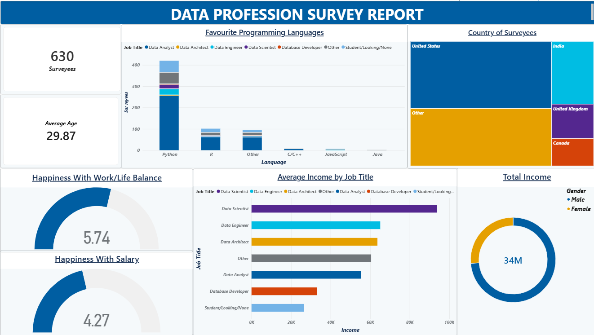

# DATA PROFESSION SURVEY REPORT (Power BI)

### Business Problem
Extracting actionable workforce insights from a messy, multi-column global survey of **630 data professionals** to analyze compensation, tooling preferences, and job satisfaction across roles.

### Tech Stack & Skills
* **Tool:** Microsoft Power BI Desktop (`.pbix`)
* **Data Transformation:** Power Query Editor (ETL pipeline, column unpivoting, string normalization)
* **Visualizations:** Treemap, Clustered Column Chart, Horizontal Bar Chart, Gauge/Card KPIs, Donut Charts

### What I Did
1. **ETL & Power Query Cleansing:** Handled missing values, standardized inconsistent job titles, and unpivoted multi-choice programming language columns into structured relational rows.
2. **Data Modeling:** Set up dimensional aggregations for average age (`29.87`), total sample size (`630`), and total tracked income (`34M`).
3. **Exploratory Visual Design:** Built an executive dashboard highlighting that **Data Scientists** and **Data Engineers** command the highest average compensation, **Python** dominates as the primary language (with **R** and **C/C++** following), and respondents report moderate work-life balance (`5.74`) versus lower salary satisfaction (`4.27`).

### Visual Evidence

### Files Included
* [Download .pbix Report File](Project%20in%20Power%20BI.pbix)
